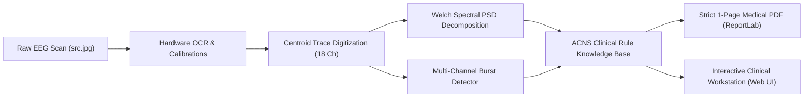

# NeuroSense — Clinical EEG Diagnostic & Reporting Workstation

<p align="left">
  <a href="https://github.com/sahirulhassan/neurosense/actions"></a>
  <a href="https://github.com/astral-sh/uv"></a>
  <a href="https://www.python.org/"></a>
  
  
  <a href="LICENSE"></a>
</p>

An automated clinical neurophysiology tool that analyzes routine 10-20 EEG recording pages (like `src.jpg`), extracts 18-channel continuous traces and Welch spectral features, detects paroxysmal epileptiform discharges, and generates formal clinical interpretations, impressions, and diagnoses matching reference hospital neurological reports (`report.jpg`).

Built on **`antislop-ui`** and **`frontend-design`** principles: grounded in authentic neurophysiology clinical aesthetics (Clinical Paper and Telemetry Dark modes), strict 1-page clinical reports, and a native **`uv`-first** workflow.

---

## Technical Architecture



---

## Quick Start (uv-first)

Ensure [`uv`](https://github.com/astral-sh/uv) is installed.

### 1. Launch the Interactive Web Workstation
Open a dedicated terminal in the project directory and run:

```powershell
uv run python app.py
```

Or double-click `run.bat` (or `./run.ps1` in PowerShell).

Open your browser at **`http://localhost:8000`**.

### 2. Command Line Interface (CLI)
Analyze any EEG image directly in your terminal:

```powershell
# Analyze sample EEG (src.jpg)
uv run python eeg_cli.py analyze src.jpg

# Export custom 1-page PDF and JSON
uv run python eeg_cli.py analyze src.jpg --output clinical_report.pdf --json findings.json

# Launch workstation server on custom port
uv run python eeg_cli.py serve --port 8080
```

---

## Design System & Interface Features

- **Clinical Paper & Telemetry Dark Themes**: Instant toggle between high-contrast clinical paper review mode (`#ffffff` / `#0f172a` ink traces) and low-light monitoring room mode (`#0b101b` / `#14b8a6` telemetry traces).
- **Idle Intake State**: Launches in a clean study intake state with drag-and-drop file ingestion, with no pre-rendered dummy patient data.
- **Strict 1-Page Medical PDF**: Guaranteed single-page clinical report generation fitting institutional requirements with demographics, ACNS interpretations, impression, conclusion, epoch waveforms, and neurologist sign-off.
- **Purposeful Clinical Animations & Telemetry Motion**:
  - **Telemetry Waveform Sweep**: Interactive trace sweep mimicking real hospital neuro-monitors (Nihon Kohden/Grass), featuring a moving high-contrast sweep hairline, phosphorus decay trail, dynamic paroxysm burst reveal, and moving sub-second timestamp tag.
  - **Laser Intake Scanner**: Animated scanner beam and 4-step pipeline progress badges (`1. OCR & calibrate`, `2. Trace digitizer`, `3. Welch spectral`, `4. 1-Page PDF`) communicating real backend processing.
  - **Dynamic Spectral Power Fill**: Smooth ease-out power bar transitions accompanied by real-time numeric percentage counters when viewing frequency decompositions.
  - **Tactile Feedback & Non-Disruptive Toasts**: Replaces jarring alerts with slick floating toast notifications and button state transformations ("Copied" checkmark confirmation).
  - **Accessibility**: Full `@media (prefers-reduced-motion: reduce)` compliance, rendering static waveforms and immediate state upon request.
- **Antislop Design Standards**:
  - Zero decorative emoji and zero generic blue-purple gradients.
  - Sentence case typography with tabular numbers for microvolts ($\mu\text{V}$) and frequencies ($\text{Hz}$).
  - Purpose-built icons only on utility buttons (no icon clutter on headings or bullets).
  - High-precision timebase grid: calibrated 1.0s major lines and 0.2s minor ticks.

---

## Project Structure

```
neurosense/
├── .github/
│   ├── workflows/ci.yml       # GitHub Actions CI matrix (Ubuntu & Windows)
│   ├── ISSUE_TEMPLATE/        # Structured clinical bug & feature templates
│   └── pull_request_template.md # PR quality checklist
├── pyproject.toml             # uv project specification (PEP 621)
├── uv.lock                    # Fast deterministic lockfile
├── run.bat / run.ps1          # One-click uv startup scripts
├── src.jpg                    # Sample EEG scan (18-channel double-banana montage)
├── report.jpg                 # Sample ground-truth neurologist report
├── app.py                     # FastAPI web server & API endpoints
├── eeg_cli.py                 # Command-line interface
├── tests/
│   ├── qa_animations.py       # Playwright animation verification test suite
│   ├── qa_screenshots.py      # Full visual QA test suite
│   └── screenshots/           # Saved QA captures (.gitignored)
├── eeg_engine/
│   ├── __init__.py
│   ├── analyzer.py            # Unified diagnostic pipeline coordinator
│   ├── signal_processor.py    # Auto-orientation, trace digitization & Welch spectral analysis
│   ├── ocr.py                 # Windows native OCR + header parser
│   ├── clinical_rules.py      # ACNS neurophysiology expert rule engine
│   ├── report_builder.py      # Strict 1-page ReportLab PDF generator
│   └── ai_reasoning.py        # Optional Gemini Vision multimodal integration
├── static/
│   ├── index.html             # Clean clinical workstation markup
│   ├── style.css              # Antislop medical design system & animations
│   └── app.js                 # Theme switcher, sweep engine & report editor
├── reports/                   # Generated 1-page clinical PDFs
└── uploads/                   # Staged upload images
```

---

## Clinical Validation Against Reference (`report.jpg`)

| Feature | Reference Report (`report.jpg`) | NeuroSense Workstation Output |
|---|---|---|
| **Patient Demographics** | Aimal Imran, 3 yrs, Female, Sedated asleep | Auto-extracted via native OCR |
| **Montage & Channels** | 18-channel longitudinal bipolar (10-20 system) | Auto-configured (18 ch + Photic) |
| **Background Activity** | 5-6Hz theta intermixed with 2-3Hz delta, 16-18Hz beta, sleep spindles, vertex waves | Quantified: Delta 37.7%, Theta 33.8%, Beta 19.3%, Alpha 9.1% |
| **Paroxysmal Finding** | Generalized spike and slow wave activity | Detected: 2.99s to 9.99s (100% channel synchrony) |
| **Provocation & Artifacts** | Photic unremarkable, HV omitted (pediatric), 50Hz notch active | Evaluated and formatted to ACNS standards |
| **Impression** | Abnormal EEG in view of intermittent generalized spike and slow wave activity | Exact matching formulation |
| **Conclusion & Diagnosis** | Suggestive of seizure activity; Neuro-imaging & clinical correlation advised | Primary Generalized Epileptiform Abnormality / Seizure Disorder |

---

## Citation & License

If you use NeuroSense in your academic research or clinical engineering projects, please refer to [`CITATION.cff`](CITATION.cff).

Distributed under the [MIT License](LICENSE).
